<div align="center">

# Asterion

*Every foreign key is a thread: follow it through the labyrinth of your tables.*

**See your schema.** A PostgreSQL schema designer that runs entirely in your browser:
as an atlas of domains, a precise blueprint, or a constellation to explore.

[](https://valkea.github.io/Asterion/)

[](https://github.com/valkea/Asterion/actions/workflows/pages.yml)
[](#more-features)
[](#why-asterion)
[](#why-asterion)
[](#why-asterion)
[](#develop)
[](#develop)

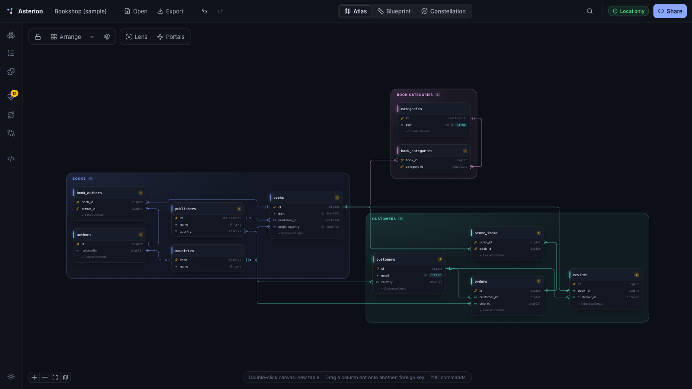

</div>

## Why Asterion

- 🔒 **Nothing leaves your browser.** Your SQL is parsed, checked and drawn on your device. There is no
  server, and the production build ships a Content-Security-Policy that forbids the page from
  contacting any other host, so the browser itself enforces it.
- ✈️ **Works fully offline.** After the first visit the whole app is cached on your device: unplug and
  keep working, or install it as an app.
- 🙈 **No account, no tracking.** No sign-up, no cookies, no analytics.
- 🔗 **The link is the file.** The whole schema (tables, enums, extensions, relationships, groups,
  notes and positions) is packed into the part of the URL after `#`, which browsers never send to
  any server. Share the link to share the schema; bookmark it to save your work.

> [!TIP]
> A bookmark only holds the version you bookmarked. Also keep a copy with **Export → SQL + layout**:
> it's plain SQL that re-opens with your positions, groups and notes.

## What sets it apart

Most online diagram tools stop at drawing the tables. Asterion also tidies, checks, explains and
compares your schema.

### 🧭 Arrange: a clean layout in one click

Press <kbd>L</kbd>. Each group is laid out as an island and the islands are placed around each other.
Asterion tries several strategies and keeps the one with the fewest crossing lines. Arrange **by
group** (it picks the cleanest direction itself) or **by dependency** (left to right, or top to
bottom). Lock a table or a group and it never moves; everything else is placed around it.
**Suggest groups** finds clusters of closely linked tables and proposes them as groups.

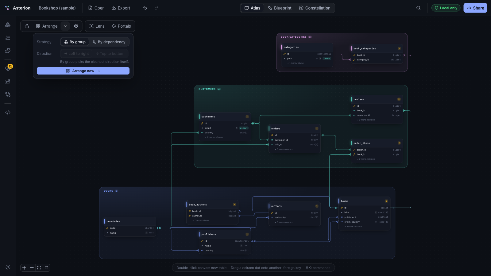

### 🩺 Health: problems found as you type

Live checks over the whole schema, most with a one-click fix: foreign-key columns without an
index, redundant indexes, foreign keys whose type doesn't match the column they point to, extension
types used without the extension, `SET NULL` on a `NOT NULL` column, double-escaped comments,
mixed-case names, unused enums… Click an issue to jump to it.

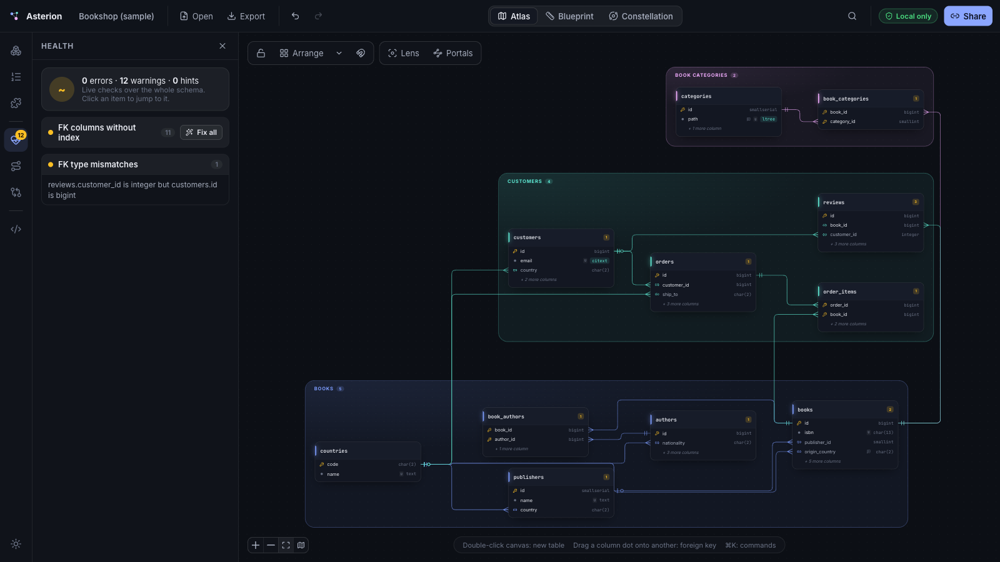

### 🔀 Join paths: from two tables to a ready-to-run query

Pick two tables. The shortest chain of foreign keys between them lights up on the canvas, and you
get the `SELECT … JOIN …` to copy.

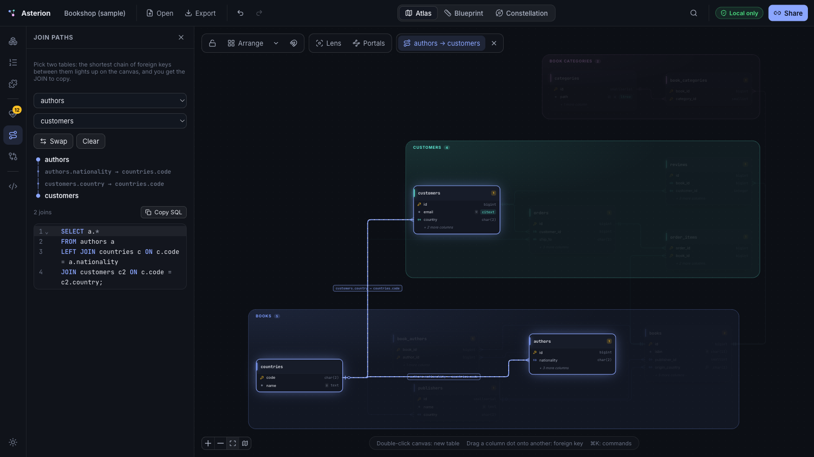

### 🆚 Compare: see what changed, get the migration

Load an older version (a file, pasted SQL or a link). New and changed tables are marked on the
canvas, every difference is listed, and you get the migration script (`BEGIN; … ALTER TABLE …`) to
copy or download.

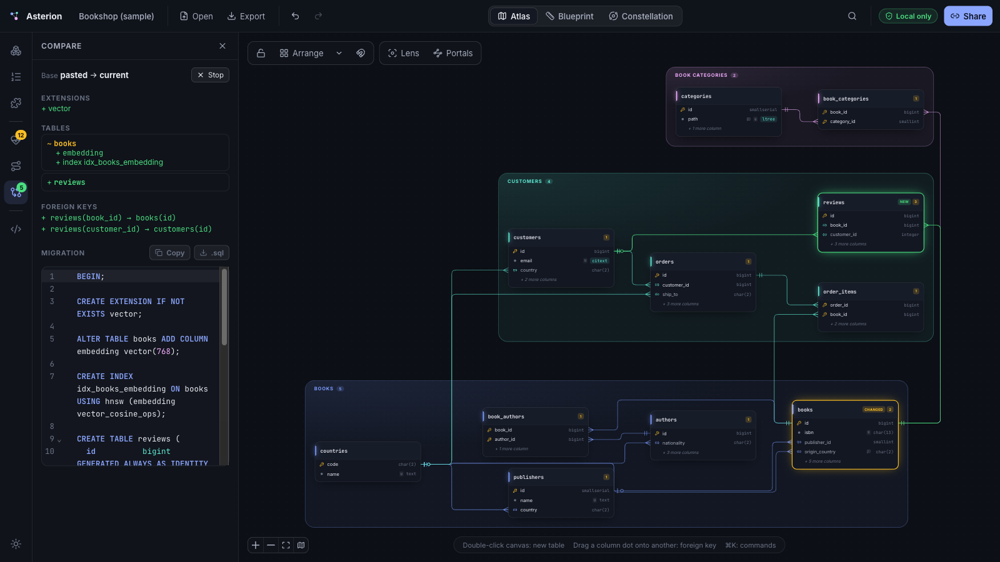

### 🔎 Search: jump to any table

Press <kbd>⌘K</kbd> (or the magnifier at the top) and start typing. Search matches table names and
column names: type `country` and every table with a country column shows up. Pick one and the
canvas flies straight to it. The same box also runs commands: new table, Arrange, switch view…

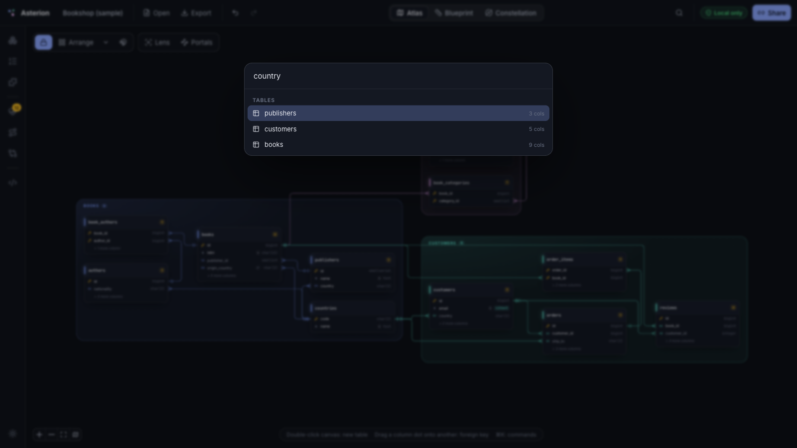

## Three ways to look at a schema

Switch views with <kbd>1</kbd> <kbd>2</kbd> <kbd>3</kbd>, or the switcher at the top of the screen. Every view comes
in a dark and a light theme: switch with the button at the bottom left.

### 🗺️ Atlas: the map of your domains

Groups become tinted islands, and the detail follows the zoom:

| Close up | Zoomed out | Far away |
| --- | --- | --- |
| Every column with its type, default, check and comment | Each table is a block with its name in large type, its column count and its warnings | Only the groups, with their table count and the links between them |

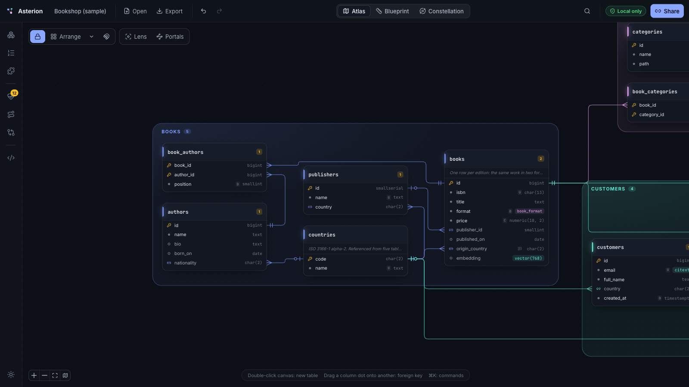
<p align="center"><sub>Close up</sub></p>

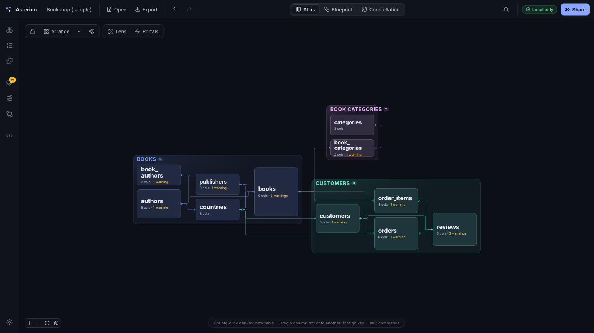
<p align="center"><sub>Zoomed out</sub></p>

<p align="center">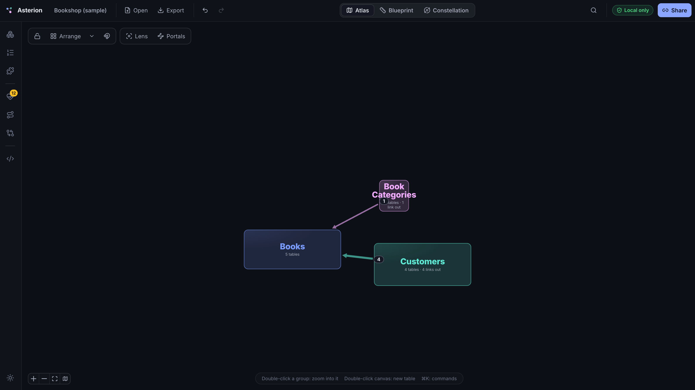</p>
<p align="center"><sub>Far away</sub></p>

When a lookup table is referenced from everywhere, its lines cross the whole map. Turn on
**Portals** and those references become small chips instead: the hub table gets a coloured mark,
and every chip that leads to it has the same mark. Hover the mark to draw its lines, click a chip
to fly there.

### 📐 Blueprint: the precise diagram

A classic entity-relationship diagram (ERD) with crow's-foot notation on drafting paper: every
column, every key. Use it to print or export.

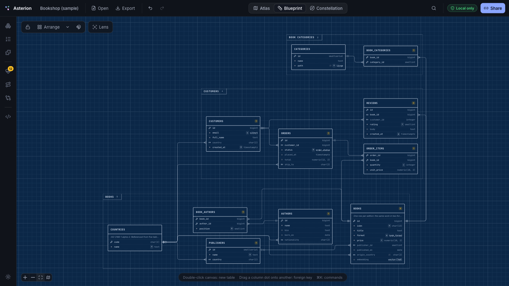

### ✨ Constellation: explore the connections

Tables become stars, sized by their columns and links, and grouped together. Click a star to put it
at the centre: every other table moves into an orbit based on how many foreign-key hops away it is.

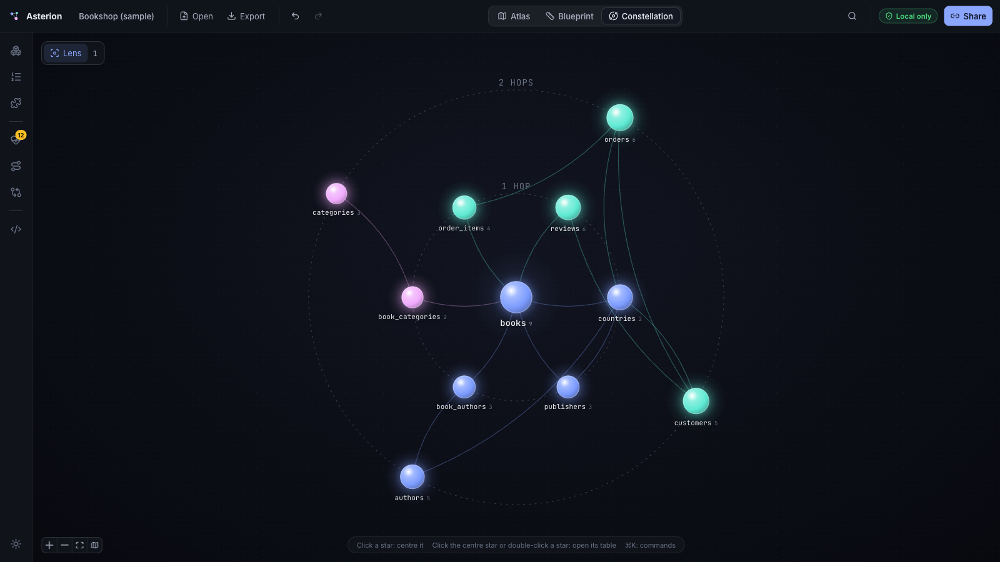

Hover any other star to explore around it without moving anything: its links light up, each
nearby star shows how many hops away it is, and everything beyond the lens reach fades.

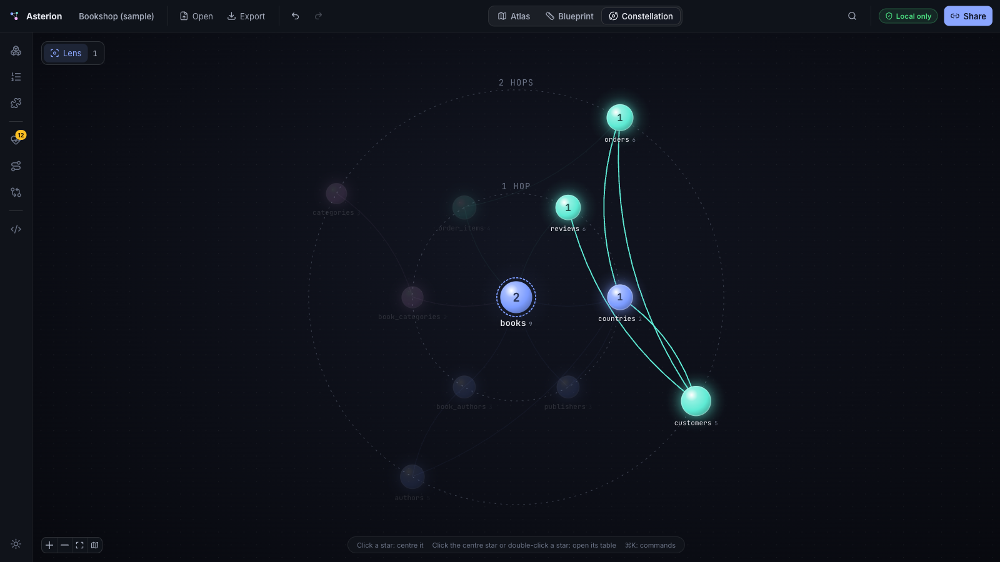

## More features

<details open>
<summary><b>Live SQL twin</b>: the SQL and the canvas stay in sync</summary>

<br>

Press <kbd>S</kbd> to open the SQL next to the canvas. Edit the PostgreSQL DDL (the `CREATE`
statements) and the canvas follows; edit the canvas and the SQL is rewritten. Errors show up inline
and pause syncing instead of breaking the drawing. Statements Asterion doesn't draw (views,
functions, triggers…) are kept as you wrote them.

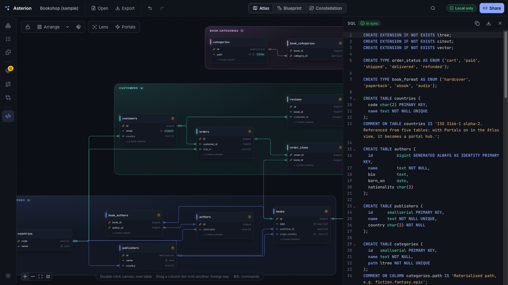

</details>

<details>
<summary><b>Lens, Portals, notes and status</b></summary>

<br>

- **Lens** (<kbd>F</kbd>): fades every table more than N foreign-key hops away from the selected one.
- **Portals** (off by default): turn busy lookup tables into hubs whose references are drawn as
  chips. Pick how many incoming foreign keys make a hub, and set each table to *auto*, *always* or
  *never*.
- **Sticky notes** attached to tables, and a **status** per table (draft, deprecated).

</details>

<details>
<summary><b>What PostgreSQL features are supported</b></summary>

<br>

- Tables, columns, primary and foreign keys with `ON DELETE` / `ON UPDATE` actions
- Enums and extensions (ltree, pgvector, PostGIS, citext, pgcrypto, pg_trgm, …)
- Indexes, including partial, GiST, GIN and HNSW
- Unique and check constraints, identity and generated columns
- Comments on tables and columns

</details>

<details>
<summary><b>Import, export and keyboard shortcuts</b></summary>

<br>

**Import** a `.sql` file (open it or drop it anywhere on the page), or paste SQL.
**Export** plain SQL, SQL with the layout saved in a comment at the end, or a PNG image.

| Shortcut | Action |
| --- | --- |
| <kbd>⌘K</kbd> | Search tables and columns, run commands |
| <kbd>1</kbd> <kbd>2</kbd> <kbd>3</kbd> | Atlas, Blueprint, Constellation |
| <kbd>S</kbd> | Live SQL pane |
| <kbd>L</kbd> | Arrange |
| <kbd>F</kbd> | Focus lens |
| <kbd>T</kbd> / <kbd>N</kbd> | New table / new note |
| <kbd>⌘Z</kbd> / <kbd>⇧⌘Z</kbd> | Undo / redo |
| <kbd>Esc</kbd> | Clear the selection |
| Double-click the canvas | New table |
| Drag a column's dot onto another column | New foreign key |

</details>

## Develop

```bash
npm install
npm run dev        # http://localhost:5173
npm test           # parser, layout, lint, diff/migration tests
npm run build      # static site in dist/
```

Every push to `main` runs the tests and the type-check, then deploys to GitHub Pages.

<details>
<summary><b>Stack and project layout</b></summary>

<br>

React 19, React Flow (`@xyflow/react`), elkjs, d3-force, graphology, CodeMirror 6, zustand + immer,
fflate.

| Folder | Contents |
| --- | --- |
| `src/sql/` | A hand-written, error-tolerant PostgreSQL DDL parser, and the SQL generator |
| `src/layout/` | The layout engines (Arrange, constellation, line routing) |
| `src/analysis/` | Health checks, compare/migration and join paths |
| `src/canvas/` | The canvas, its tables and its lines |
| `src/panels/` | The UI around the canvas |
| `src/share/` | Packing the schema into the URL |

</details>
